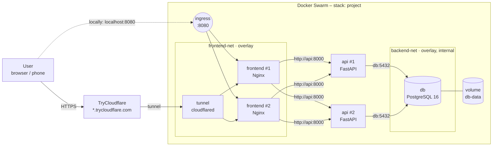

# Task Manager – Docker Swarm project

*Cloud-Based Architectures and Service Management – practical project assignment*

**Public URL:** `https://<goes-here>.trycloudflare.com` *(temporary, refreshed before the demo)*

## 1. Purpose of the application

A simple, multi-user task manager. In the browser, users can add tasks, move them through
statuses (to do → in progress → done), filter them and delete them.
Data is stored in PostgreSQL on a persistent volume.

The **Infrastructure** panel at the bottom of the UI shows which frontend replica and which API
replica served each request. This makes load balancing, scaling and self-healing visible
right in the browser.

## 2. Architecture



| Service | Image | Replicas | Network | Public port | Role |
|---|---|---|---|---|---|
| `frontend` | own: `task-manager-frontend` (based on nginx:1.27.3-alpine) | 2 | frontend-net | **8080** | static UI + reverse proxy to `/api` |
| `api` | own: `task-manager-api` (based on python:3.12.8-slim) | 2 (→3) | frontend-net, backend-net | – | REST API, business logic |
| `db` | `postgres:16.6-alpine` | 1 | backend-net | – | persistent storage (`db-data` volume) |
| `tunnel` *(helper)* | `cloudflare/cloudflared:2024.12.2` | 1 | frontend-net | – | public URL |

**Security:**
- only the frontend publishes a port;
- the database sits on an `internal` overlay network that only the API can reach;
- the DB password is a Docker secret (`/run/secrets/db_password`) and is not in the repo;
- the API does not run as root;
- every image version is pinned.

### API endpoints

| Method | Path | Description |
|---|---|---|
| GET | `/api/tasks` | list tasks |
| POST | `/api/tasks` | new task `{"title": "..."}` |
| PATCH | `/api/tasks/{id}` | change status `{"status": "todo" \| "in_progress" \| "done"}` |
| DELETE | `/api/tasks/{id}` | delete |
| GET | `/api/info` | serving replica, version, DB status |
| GET | `/health` | healthcheck (inside the container only) |

## 3. Prerequisites

- Docker Engine 24+ or Docker Desktop (with the Compose v2 plugin)
- A GitHub account (GHCR) or a Docker Hub account for the images
- Internet access (image pulls, TryCloudflare)

## 4. Running locally with Docker Compose

```bash
printf 'some-strong-password' > secrets/db_password.txt
docker compose up --build
# -> http://localhost:8080
docker compose down          # stop (the data stays in the volume)
```

## 5. Build and push to the registry

```bash
export IMAGE_PREFIX=ghcr.io/<github-username>
export TAG=1.0.0
echo <GITHUB_TOKEN> | docker login ghcr.io -u <github-username> --password-stdin
./scripts/build-and-push.sh
```

> On GHCR, set the packages to **Public** visibility so that any node can pull them.

## 6. Deploying to Docker Swarm

```bash
docker swarm init                     # with multiple IPs: --advertise-addr <IP>
docker node ls
printf 'some-strong-password' | docker secret create db_password -
export IMAGE_PREFIX=ghcr.io/<github-username> TAG=1.0.0
docker stack deploy -c stack.yml project
docker stack services project
docker stack ps project
```

`scripts/deploy.sh` does all of this in one go.

**Getting the public URL:**
```bash
docker service logs project_tunnel 2>&1 | grep -o 'https://[a-z0-9-]*\.trycloudflare\.com' | tail -1
```
*(Alternative on the host: `cloudflared tunnel --url http://localhost:8080`.)*

**Removal:** `docker stack rm project`. The volume is kept; delete it with `docker volume rm project_db-data`.

## 7. Testing

`./scripts/demo.sh` walks through the tests step by step.

| Test | Command | Expected result |
|---|---|---|
| Functional | UI: add a task, refresh | the task appears and persists |
| Load balancing | UI: "Send 20 requests" | both API replicas answer |
| Scaling | `docker service scale project_api=3` | 3/3 replicas, 3 different `served_by` values |
| Self-healing | `docker kill <api-container>` → `docker service ps project_api` | the old task is *Failed/Shutdown*, a new one is *Running* |
| Persistence | `docker service update --force project_db` | new DB container, data still there |
| External access | the trycloudflare URL over mobile data | the app loads and works |
| Rolling update *(extra)* | `TAG=1.0.1 ./scripts/build-and-push.sh` → `docker service update --image …:1.0.1 project_api` | the API version becomes 1.0.1 with no downtime |

Outputs and screenshots are in the `docs/` folder.

## 8. Known limitations

- **Single node:** Swarm handles container-level failures; node-level fault tolerance cannot be demonstrated with one machine.
- **The DB is not replicated:** the `local` volume is tied to one node, so `db` is pinned to the manager node.
  Multiple nodes would need shared storage (NFS) or Postgres replication.
- **Temporary URL:** the TryCloudflare URL changes on every tunnel restart and has no availability guarantee.
- **No user accounts:** every visitor sees the same list (demo application).

## 9. Repository layout

```
api/              FastAPI backend + Dockerfile
frontend/         Nginx config, static UI + Dockerfile
compose.yml       local run and build (Docker Compose)
stack.yml         Swarm deployment (docker stack deploy)
scripts/          build-and-push.sh, deploy.sh, demo.sh
secrets/          (git-ignored) local password file
docs/             explanation, test outputs, screenshots
```
